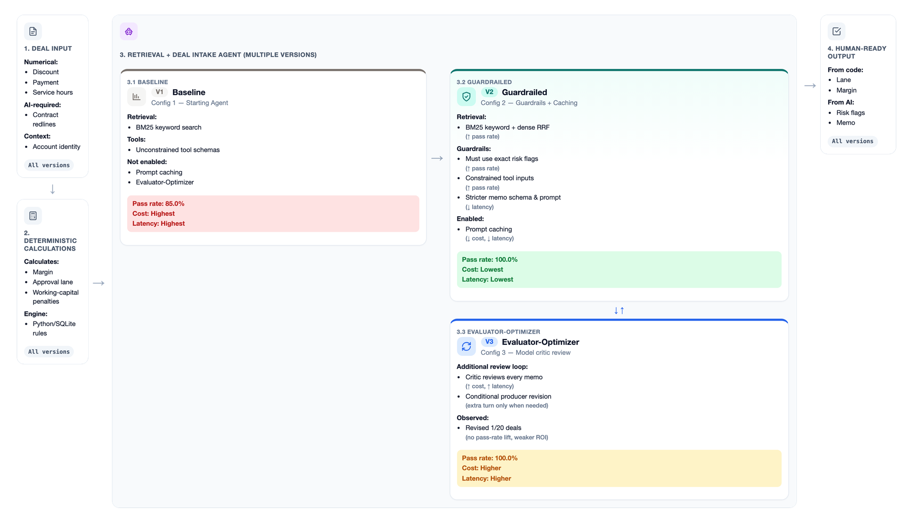
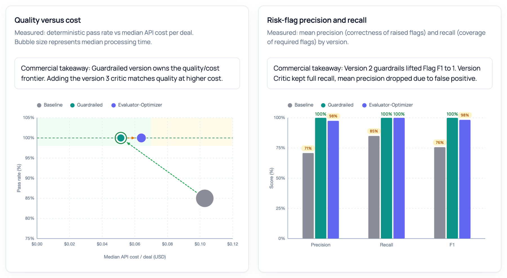
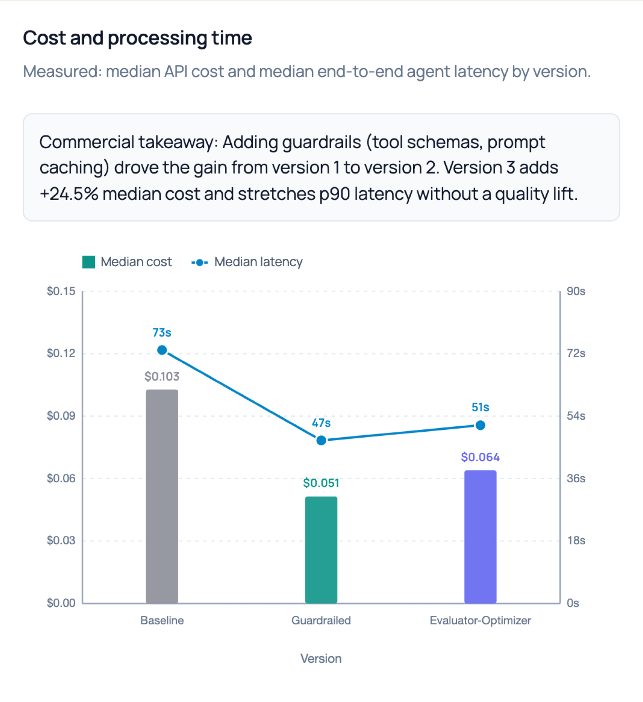
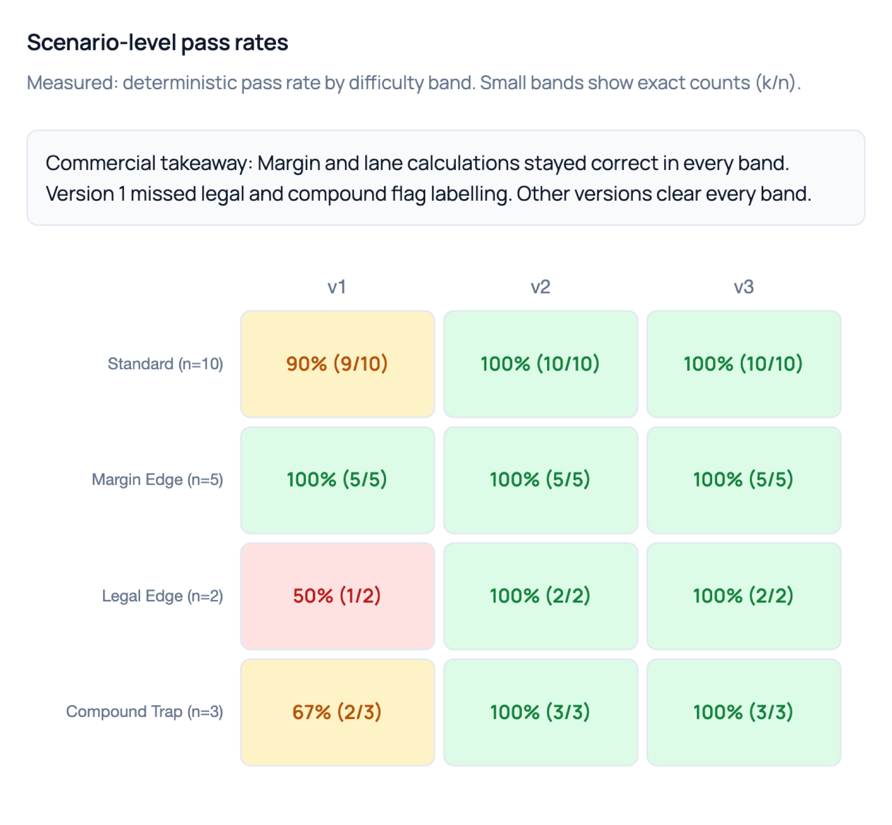

# Inside the AI Deal Desk

**Deterministic margin guardrails + constrained AI for enterprise deal review** — with per-run cost instrumentation and a 60-run evaluation suite.

[](LICENSE)

[Companion dashboard](#-companion-dashboard) · [Quickstart](#-quickstart) · [Benchmark results](#-benchmark-results) · [Architecture](#-architecture)

Enterprise B2B SaaS companies often lose margin—and deal velocity—when discounts, Net-60/90 terms, unbilled onboarding, and legal redlines stack without a single system that recomputes economics and routes approvals. This repo implements a framework-free Python + SQLite deal-desk agent on the Anthropic Messages API:

- **Code owns the math** — list ARR, COGS, working-capital penalties, gross margin, and approval lanes
- **AI owns unstructured judgment** — redlines, risk flags, policy grounding, executive memos
- **Humans keep the final call** — VP-Sales, CFO, and Legal retain sign-off

Three configurations were evaluated on the same **20 adversarial scenarios** (**60 runs** total). **Version 2 (guardrailed)** is the recommended default: **100%** deterministic pass, **1.00** risk-flag F1, **−50%** median API cost and **−35.7%** median latency vs baseline.

---

## What you get

| Capability | What it does |
|---|---|
| **Deterministic unit economics** | Margin waterfall, Net-60/90 penalties, 72% floor, approval-lane matrix in Python/SQLite |
| **Constrained tool-using agent** | Raw Anthropic Messages API loop (`v1` / `v2` / `v3`) with poka-yoked schemas in v2+ |
| **Hybrid policy retrieval** | BM25 (v1) or BM25 + dense RRF (v2/v3) over Deal-Desk policies + CUAD-style clauses |
| **Evaluator-Optimizer critic (v3)** | Optional second-pass review with conditional producer revision |
| **Cost & latency ledger** | Token/USD/cache/latency rows for apples-to-apples experiment comparison |
| **Automated evals** | Deterministic graders + independent LLM-as-a-Judge (`claude-opus-4-6`) |
| **Companion dashboard** | Self-contained HTML evidence locker for charts, failures, and case traces |

---

## How the pipeline works

Deal intake → deterministic margin & lane calculations → AI review (retrieval + risk flags + memo) → human-ready brief.



*Figure 1. End-to-end flow: deterministic calculations first, then retrieval and agents, then human-ready output.*

---

## Benchmark results

**Status: complete** — 60/60 runs · unit tests **31/31** · rates pinned as of 2026-11-21.

| Metric | v1 Baseline | **v2 Guardrailed (recommended)** | v3 + Critic |
|---|---:|---:|---:|
| Deterministic pass rate | 85% (17/20) | **100% (20/20)** | **100% (20/20)** |
| Risk-flag F1 | 0.757 | **1.000** | 0.983 |
| Median API cost / deal | $0.103 | **$0.051 (−50%)** | $0.064 (+24.5% vs v2) |
| Median latency (p50) | 73s | **47s (−35.7%)** | 51s |
| p90 latency | 86s | **77s** | 88s |

### Quality vs cost, and risk-flag precision/recall



*Figure 2. Guardrailed v2 owns the quality/cost frontier. Canonical risk-flag constraints lift F1 from 0.76 → 1.00.*

### Cost and processing time



*Figure 3. Prompt caching and fewer JSON repairs drive the v1→v2 gain. v3 adds cost and a slower p90 without a quality lift.*

### Scenario-level pass rates



*Figure 4. v1 drops on `edge_legal` and `compound_trap`; v2 and v3 clear every band.*

**Practical takeaway.** For standard, margin-trap, and most legal deals, **v2 is the production default**. Reserve **v3** when an independent critic pass is worth the unit-cost premium; it is not required to hit the golden-suite deterministic bar once v2 tooling is in place.

Lane and margin accuracy were **100% across all three versions** — failures concentrated in unstructured risk-flag labelling, not spreadsheet math.

---

## Companion dashboard

Open the self-contained evidence locker (no CDNs, no network fetches):

```bash
python -m src.build_report
# then open results/index.html
# or: python3 -m http.server 8765
# → http://127.0.0.1:8765/results/index.html
```

The dashboard includes version comparison, primary charts, methodology, failure taxonomy, cost/latency detail, monthly API-cost projection, and a case explorer with traces.

---

## Quickstart

**Requirements:** Python 3.10+ · Anthropic API key

```bash
python -m venv .venv && source .venv/bin/activate
pip install -r requirements.txt
cp .env.example .env   # set ANTHROPIC_API_KEY=

python db/seed_db.py
pytest -v

# Single golden case
python -m src.agent --case-id GE-015 --version v2

# Custom AE deal payload
python -m src.agent --deal-json path/to/deal.json --version v2

# Full cross-version eval (20 cases × 3 versions)
python -m src.evals --versions v1 v2 v3 --workers 3

# Rebuild the companion dashboard
python -m src.build_report
```

Custom deals: pass `--deal-json <path>` with account, ACV, term, discount, payment terms, services hours, and redline text. Overrides `--case-id` and runs as `case_id=CUSTOM`.

---

## Architecture

```text
db/          SQLite warehouse, seed script, RAG chunks, cost ledger, eval_results
src/         Deterministic tools, Hybrid RAG, agent (v1/v2/v3), evals, report builder
tests/       Seed integrity, tools/RAG, mocked agent loop, offline graders
outputs/     Benchmark CSV/JSON from the 60-run suite
results/     Companion dashboard dataset (+ generated index.html)
docs/assets/ Figures used in this README
```

### Versions

| Version | Configuration |
|---|---|
| **v1** | Baseline AI agent — BM25 retrieval, basic tools. No prompt caching or critic. |
| **v2** | Guardrailed AI agent — poka-yoked tool schemas, hybrid BM25 + dense RRF, Anthropic prompt caching. |
| **v3** | Evaluator-Optimizer — same basis as v2, plus critic and conditional producer revision. |

### Evaluation design

- **20 golden scenarios** — standard, `edge_margin`, `edge_legal`, `compound_trap`
- **Deterministic grading** — approval-lane exact match; margin within tolerance; risk-flag precision / recall / F1
- **LLM-as-a-Judge** — independent `claude-opus-4-6` scores each memo against a rubric (commercial accuracy, policy grounding, executive clarity, actionability) on a 1–5 scale
- **Paired design** — every scenario runs under v1, v2, and v3

Seeded warehouse: **250** historical deals, **16** RAG chunks, **20** formula-verified golden cases. Dense embeddings for Hybrid RAG are computed locally and stored in SQLite — no third-party embedding API.

---

## Overall benchmark table

From `outputs/benchmark_summary.csv`:

| Version | Det. Pass % | Flag F1 | Mean Cost (USD) | p50 Cost | p50 / p90 Latency (s) | Avg Cache Hit % |
|---|---:|---:|---:|---:|---|---:|
| v1 | 85.0 | 0.757 | 0.0967 | 0.1029 | 73.1 / 86.0 | 0.0 |
| v2 | 100.0 | 1.000 | 0.0606 | 0.0514 | 47.0 / 76.8 | 57.0 |
| v3 | 100.0 | 0.983 | 0.0813 | 0.0640 | 51.4 / 88.3 | 49.4 |

v1 failed deterministic pass on GE-009 / GE-018 / GE-019 via non-canonical or prose-annotated flag strings (lane + margin were already exact). v2 and v3 rescued all three. v3’s critic revised **1/20** runs (GE-016).

---

## Limitations

- Single run per scenario × version (no run-to-run consistency estimate)
- n=20 overall; `edge_legal` (n=2) and `compound_trap` (n=3) are small
- McNemar on v1→v2 pass improvement is underpowered (exact p=0.25)
- Opus judge scores sit near the 5.0 ceiling, so writing quality barely discriminates versions
- Any benefit of the v3 critic on high-stakes deals remains a hypothesis, not a proven result

---

## License

MIT © 2026. See [LICENSE](LICENSE).
